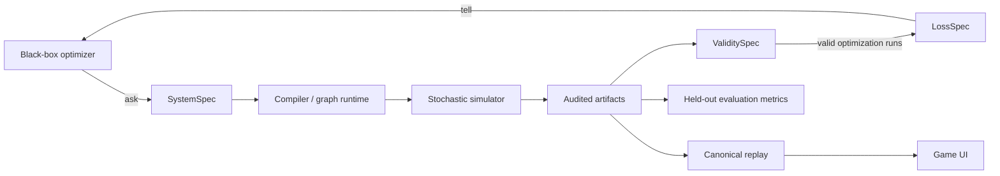

# Architecture

## System boundary

Science Utopia Lab treats the complete scientific system as the design object.
Peer review is one optional mechanism among evaluation, publication, funding,
governance, communication, education, employment, and custom mechanisms.



The general graph runtime is still in progress. Today, the legacy compiler
executes a restricted fixed-topology `SystemSpec`; the persistent campaign
controller closes ask/register/run/observe/tell over that executable subspace.
The replay/game path is an implemented presentation foundation.

## Packages and responsibilities

| Path | Responsibility |
|---|---|
| `utopia/system/` | `SystemSpec`, mechanism graph types, validation, legacy compiler |
| `utopia/optimization/` | design spaces, run registry, scheduler, loss-facing ask/tell boundary |
| `utopia/mechanisms/` | replaceable mechanism implementations and contracts |
| `utopia/replay/` | canonical events, deterministic projection, viewer payload |
| `utopia/experiments/` | upstream and legacy experiment drivers |
| `utopia/analysis/` | numerical summaries and release validation |
| `game-ui/` | presentation-only local replay viewer |
| `research/specs/` | versioned schemas and concrete study definitions |
| `outputs/` | ignored raw run artifacts |

## Optimization roles

Keep these objects separate:

| Object | Role |
|---|---|
| `SystemSpec` | candidate system the optimizer may change |
| `LossSpec` | signal returned to the optimizer on optimization seeds |
| `ValiditySpec` | determines whether an observation is technically usable |
| `EvaluationMetricSpec` | held-out description of a frozen candidate |
| `DecisionPolicy` | optional post-evaluation promotion rule |

Technical failure is not a bad scientific outcome, and a held-out metric is not
held out after it is used to tune a candidate.

## Data and provenance

Every long run is tied to a source commit, study revision, design fingerprint,
seed, model/backend identity, and immutable output root. Raw data stays outside
Git. Compact results and artifact manifests record hashes and current locators.

The UI consumes `scienceutopia.replay-view.v1` payloads. It may choose visual
positions, but it must not calculate balances, publication state, or scientific
decisions independently of the Python replay projector.

## Extension points

- Add a mechanism family through typed ports and invariants.
- Add a structural search adapter without changing the optimizer ask/tell API.
- Add an optimizer backend by implementing `ask`, `tell`, and serializable
  state.
- Add a viewer by consuming canonical replay rather than simulator internals.
- Add an evaluation metric only with an explicit data split and version.

## First closed-loop execution

The production entry point is `python -m utopia.optimization.closed_loop`. Its
state machine is:

```text
init → suggest(initial) → run → observe/tell
                                  ↓
                         suggest(adaptive) → run → observe/tell
```

Suggestions are written to `campaign-state.json` before their seed-replicated
jobs enter `runs.sqlite3`. The controller can therefore reconstruct pending
optimizer state after interruption. `status` reports the current budget,
suggestion states, run states, incumbent observation, and whether held-out
seeds have been consumed.
