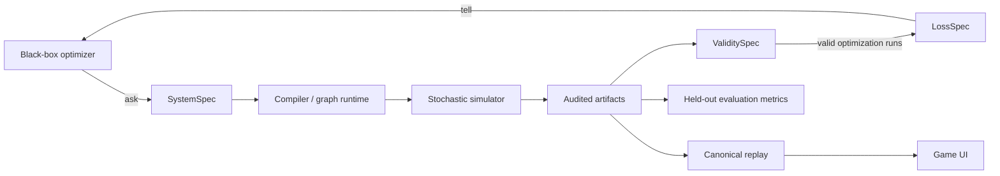

# Architecture

## System boundary

Science Utopia Lab treats the complete scientific system as the design object.
Peer review is one optional mechanism among evaluation, publication, funding,
governance, communication, education, employment, and custom mechanisms.



The generic graph runtime executes registered mechanism graphs with typed
ports, schedules, latency, state, checkpoints and canonical events. The legacy
compiler and full Qwen-agent simulator support a narrower executable topology
and explicit prospective overlays. The persistent campaign controller closes
ask/register/run/observe/tell over that subspace. An opt-in NativeScienceKernel
now binds the generic graph to the actual Simulation phases: the baseline
contains the original world, while registered, isolated Python and open LLM
institutions can exchange new protocols and affect researcher inputs or native
publication decisions. The original world is a minimum instance, not the
expressiveness ceiling. Annual domain prerequisites and new actor behavior
remain explicit integration limits; this is not unlimited process freedom.

Native joint design now has a durable `NativeDesignCampaign` and scoped
`{rationale,nodes,exports}` authoring IR. A designer writes complete Python,
ports/protocols, every wire and node order; compilation only namespaces names
and schedules the declared cut. No missing institutional algorithm or semantic
connection is inserted. Exact generated history and actual losses condition
later proposals; technical probe failures have null loss. See
[authoring and limits](../research/components/native-scoped-region-authoring-v5.md).
Graph expressiveness must not be confused with native semantic coverage:
research/submission/funding phases still share hidden annual `_frame` state,
and adding an actor-type declaration does not instantiate new actor behavior.

A second backend, `program.numeric.v1`, executes generated numeric mechanism
ASTs in a small recurrent agent world. It supports program/node/edge/process
generation, gradient-free search and direct differentiation through the
complete relaxed numeric rollout. Qwen can propose frozen programs and initial
attributes, but Qwen token generation stays outside autograd. Isolated source
now runs in the native world through declared ports; replacing every native
research/artifact protocol and differentiating that world remain gaps.
The numeric backend is method-test evidence, not a more simplified substitute
for the research world. See [native kernel](../research/components/native-science-kernel-v1.md)
and [Generative Program World](../research/components/generative-program-world-v1.md).

## Packages and responsibilities

| Path | Responsibility |
|---|---|
| `utopia/system/` | `SystemSpec`, mechanism graph types, validation, legacy compiler |
| `utopia/optimization/` | design spaces, run registry, scheduler, loss-facing ask/tell boundary |
| `utopia/mechanisms/` | replaceable mechanism implementations and contracts |
| `utopia/replay/` | canonical events, deterministic projection, viewer payload |
| `utopia/experiments/` | upstream and legacy experiment drivers |
| `utopia/analysis/` | numerical summaries and release validation |
| `game-ui/` | presentation-only local replay viewer |
| `game-ui-v2/generative.html` | recorded numeric worlds, generated rules/graphs, search paths and canonical evidence |
| `research/specs/` | versioned schemas and concrete study definitions |
| `outputs/` | ignored raw run artifacts |

## Optimization roles

Keep these objects separate:

| Object | Role |
|---|---|
| `SystemSpec` | candidate system the optimizer may change |
| `LossSpec` | signal returned to the optimizer on optimization seeds |
| `ValiditySpec` | determines whether an observation is technically usable |
| `EvaluationMetricSpec` | held-out description of a frozen candidate |
| `DecisionPolicy` | optional post-evaluation promotion rule |

Technical failure is not a bad scientific outcome, and a held-out metric is not
held out after it is used to tune a candidate.

## Data and provenance

Every long run is tied to a source commit, study revision, design fingerprint,
seed, model/backend identity, and immutable output root. Raw data stays outside
Git. Compact results and artifact manifests record hashes and current locators.

The institution designer and researcher model are distinct roles. The optional
[external manifest inbox](../research/components/native-external-manifest-authoring-v5.md)
records exact hash-bound requests and complete code/graph responses without
calling a provider API. Missing responses are resumable waiting states; consumed
raw bytes are immutable. External author metadata is self-reported, not provider
authentication or evidence that the local researcher model wrote the design.
Native checkpoint/source/code/image/raw-review and researcher-journal audits
remain mandatory regardless of designer identity.

The UI consumes `scienceutopia.replay-view.v1` payloads. It may choose visual
positions, but it must not calculate balances, publication state, or scientific
decisions independently of the Python replay projector.

## Extension points

- Add a mechanism family through typed ports and invariants.
- Add a structural search adapter without changing the optimizer ask/tell API.
- Add an optimizer backend by implementing `ask`, `tell`, and serializable
  state.
- Add a viewer by consuming canonical replay rather than simulator internals.
- Add an evaluation metric only with an explicit data split and version.
- Create new numeric mechanisms as validated AST data for the generic program
  interpreter; add a richer world observation/effect protocol explicitly when
  the existing numeric vocabulary is insufficient.
- For native-world extensions, start from `legacy_world_system()` or another
  SystemSpec; provide a registered/code/LLM implementation and explicit ports.
  `--science-system-spec PATH` selects it; omission preserves old behavior.
  `evaluate_native_suggestion()` connects that world to the existing black-box
  Observation/LossSpec contract; `NativeDesignCampaign` supplies durable source/
  region ask/execute/tell and pending-work restart. Broader native consumers and
  arbitrary new activity semantics still require implementation. Actor codecs
  extend persistence, not behavior by magic.

## First closed-loop execution

The production entry point is `python -m utopia.optimization.closed_loop`. Its
state machine is:

```text
init → suggest(initial) → run → observe/tell
                                  ↓
                         suggest(adaptive) → run → observe/tell
```

Suggestions are written to `campaign-state.json` before their seed-replicated
jobs enter `runs.sqlite3`. The controller can therefore reconstruct pending
optimizer state after interruption. `status` reports the current budget,
suggestion states, run states, incumbent observation, and whether held-out
seeds have been consumed.
