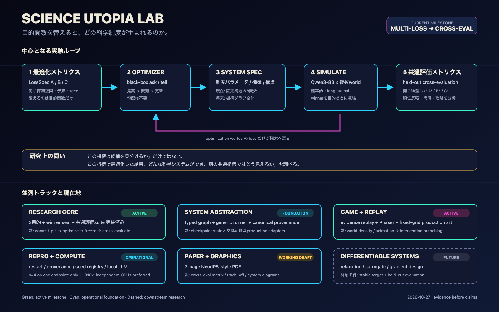

# Science Utopia Lab — program map

Updated: 2026-10-28



Editable source: [`science-utopia-program-map.svg`](figures/science-utopia-program-map.svg).

## What this project is trying to do

Treat a complete scientific system as a design object. Evaluation, publication,
funding, governance, communication, and other mechanisms may be added, removed,
replaced, parameterized, or eventually rewired. Run candidate systems as
stochastic simulations and study which institutions emerge as desirable under
different explicitly chosen objectives.

The central experiment is **metric-conditioned system optimization**:

```text
choose optimization metric A -> optimize the system -> freeze system A*
choose optimization metric B -> optimize the system -> freeze system B*
choose optimization metric C -> optimize the system -> freeze system C*
                                              |
                                              v
                 evaluate A*, B*, C* on the same held-out metric suite
```

Here, an optimization metric (`LossSpec`) is analogous to a training loss: it
changes which system the optimizer searches for. A held-out evaluation metric
(`EvaluationMetricSpec`) is analogous to accuracy, F1, calibration, or a test
set diagnostic: it is used after candidates are frozen to understand what each
objective produced. Technical validity and an optional policy decision are
separate again. Objective resolution is useful QA, but it is not the research
question by itself.

Accordingly, the central comparison is a matrix: rows are systems obtained by
optimizing different losses, while columns are shared held-out evaluation
metrics. A result such as “loss A produced system A*, which scores this way on
metrics A/B/C” is the intended evidence. Testing whether loss A can reliably
distinguish two already chosen systems is only supporting measurement QA.

## Current tracks

| Track | Current state | What is actually finished | Next evidence-producing step |
|---|---|---|---|
| Reproducible simulator | operational | local Qwen3-8B, repeated seeds, restart/provenance, longitudinal runs | keep frozen during metric-conditioned study |
| Metric-conditioned optimization | v1.1 running | v1 remains archived; repaired source `1078279` is tagged, three byte-identical initial proposals are registered in every arm, and the canonical nine-run physical batch has started | audit and adopt the nine common trajectories, finish two adaptive candidates per arm, and freeze three winners simultaneously |
| Evaluation metrics | common suite, report-only semantic instrumentation, and prospective objective landscape | executable activity/resource diagnostics and the seven-construct catalog now sit beside versioned semantic events, missingness, gaming fixtures, a fail-closed prospective recorder, a source-hash-bound audit of the three current LossSpecs, and nine next-campaign metric cards/objective relations; none changes the three frozen LossSpecs | wire the recorder only into a separately preregistered prospective campaign, validate constructs, then preregister a new split and explicit normative choice before promoting any diagnostic or metric card to a LossSpec |
| Whole-system abstraction | bidirectional simulator planning boundary | canonical runs feed typed SystemSpec workloads, while validated legacy-compatible SystemSpecs compile to sealed seed-specific simulator plans; unsupported government/new communication/topology changes fail closed instead of disappearing | implement native simulator runtimes for currently unsupported mechanisms, then execute separately preregistered structural campaigns |
| Black-box optimization | baseline operational | opaque `ask/tell`, persistent adaptive random search, real result-dependent suggestion | compare stronger methods only after the multi-loss baseline closes |
| Structural optimization | multiple production vertical slices | 145 government candidates and a separate 97-candidate communication space vary node presence, implementation, edge/fan-out presence, and latency; every candidate executes through a fingerprint-bound black-box ask/execute/loss/tell and checkpoint boundary | compare these structures under research LossSpecs after the frozen eight-parameter baseline closes |
| Differentiable systems | not started | conceptual direction only | differentiable surrogate/relaxation after stable black-box targets and measurements |
| Game and replay | research arcology, authoritative operations/interior layer, system sandbox, and optimization mission control | a pixel-art hub connects verified replay, the separate synthetic graph editor, and the hash-bound 3-arm/5-candidate/3-seed snapshot; Evidence Quay and four institutional cutaways bind research, writing, sealed review, funding, reporting, and year-close to canonical events/frames while keeping rooms, poses, motion, packets, lighting, and interpolation typed as presentation-only | deepen longitudinal researcher identity and collaboration without weakening the truth boundary, refresh snapshots only through the read-only adapter, and connect simultaneously frozen winners after completion |
| Paper and scientific graphics | pre-held-out completion analysis ready | a fail-closed development-only builder now audits 45 optimization runs, winner freeze, 15-by-3 cross-scores, uncertainty, ranking reversals, runtime/provenance, and held-out non-use before atomic paper outputs | run after simultaneous winner freeze; only then proceed to the separately sealed held-out result builder |
| Compute | measured | one local Ollama endpoint at four workers gave only about 1.016x throughput | use independent endpoints/GPUs for material parallel speedup; retain seed isolation |

## Dependency logic

The project is deliberately not a single linear backlog.

- The research core now moves from an engineering closed loop to the first
  comparison of **systems optimized under different objectives**.
- The system-abstraction track now executes small family-independent mechanism
  graphs. It next expands from examples to checkpointable production adapters,
  so the optimizer may change mechanisms and graph structure rather than only
  eight parameters in one topology.
- The game track consumes canonical replay; it does not reimplement research
  logic. It can progress while commit-pinned experiments run elsewhere.
- The paper/graphics track records claims only after their evidence boundary is
  clear, but can continuously improve explanatory diagrams and methods text.
- Differentiable optimization is downstream of a trustworthy simulator target
  and held-out evaluation suite; otherwise it would optimize an undefined
  proxy faster.

## Immediate milestone

Complete `Metric-Conditioned Optimization Study v1` without consuming its
held-out worlds early:

1. **complete:** freeze three contrasting proxy objectives, identical search
   conditions, common evaluation suite, and analysis code;
2. **in progress:** run equal-budget black-box optimization for each objective
   from the clean commit-pinned worktree;
3. freeze one winner per arm before opening the evaluation split;
4. cross-evaluate all winners on the same metrics and visualize rank reversals,
   trade-offs, generalization gaps, and proxy gaming;
5. report what changed in the optimized systems—without declaring one metric or
   system universally correct.

In parallel, expand the verified game v2 slice and turn the generic mechanism
runner into checkpointable production adapters. Long model campaigns must run
from a clean commit-pinned worktree, separate from active game and abstraction
development.

