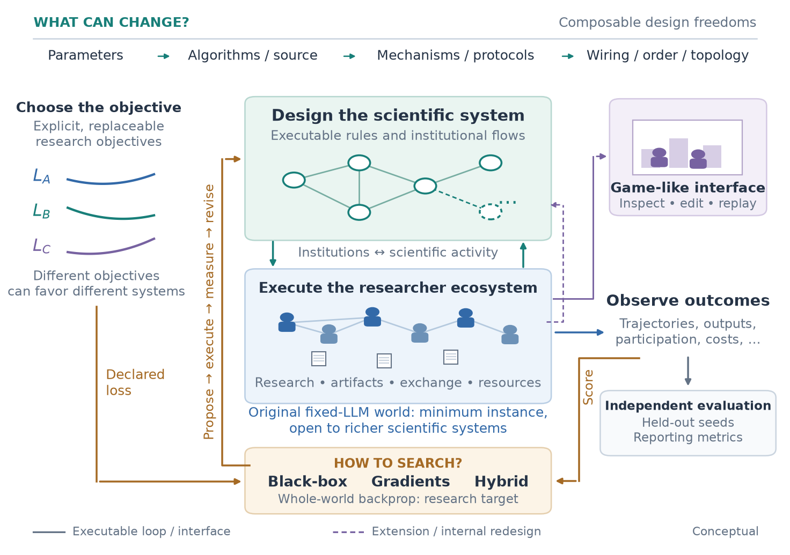

# Science Utopia Lab — program map

Updated: 2026-11-01

The current original-goal-by-goal inventory is
[Objective-conditioned design v5](milestones/2026-11-01-objective-conditioned-design-v5.md).
V5 implements joint free-code/graph authoring with explicit loss-conditioned
feedback, independent cross-loss common-initial adoption and raw-peer-score
objectives. Its first actual joint-generation attempt fails all6 drafts; a
separately registered alias-aligned follow-up also fails6 drafts. Staged graph/
source generation with corrected, type-preserving prompt examples also fails:
one graph plan passes, but no candidate reaches a fresh native world. An
explicitly separate Codex-designer/native-Qwen pilot is now running with
hash-bound complete manifests and the same two losses and small world budget.
A separate two-draw fresh-native policy-gradient batch completes and updates
probabilities, but same-action sampling does not establish comparative benefit.
Source/protocol/wiring authoring, full-native-cost distribution gradients,
visual editing and explicit durable same-society migration are implemented.
Native transition fidelity fails its unused-design check; exact finite-bank
probability fitting is separate. Two new Qwen joint-generation attempts fail
technical contracts. Useful autonomous invention, full native pathwise backward,
automatic continual adoption and recursive designer improvement remain open.
The older track table below is historical, not a current completion map.



Concept, not completion evidence. [Current editable SVG](../paper/figures/program-concept/science-system-design-program.svg).
The [earlier progress-map SVG](figures/science-utopia-program-map.svg) is retained as history.

## What this project is trying to do

Treat a complete scientific system as a design object. Evaluation, publication,
funding, governance, communication, and other mechanisms may be added, removed,
replaced, parameterized, or eventually rewired. Run candidate systems as
stochastic simulations and study which institutions emerge as desirable under
different explicitly chosen objectives.

The central experiment is **metric-conditioned system optimization**:

```text
choose optimization metric A -> optimize the system -> freeze system A*
choose optimization metric B -> optimize the system -> freeze system B*
choose optimization metric C -> optimize the system -> freeze system C*
                                              |
                                              v
                 evaluate A*, B*, C* on the same held-out metric suite
```

Here, an optimization metric (`LossSpec`) is analogous to a training loss: it
changes which system the optimizer searches for. A held-out evaluation metric
(`EvaluationMetricSpec`) is analogous to accuracy, F1, calibration, or a test
set diagnostic: it is used after candidates are frozen to understand what each
objective produced. Technical validity and an optional policy decision are
separate again. Objective resolution is useful QA, but it is not the research
question by itself.

Accordingly, the central comparison is a matrix: rows are systems obtained by
optimizing different losses, while columns are shared held-out evaluation
metrics. A result such as “loss A produced system A*, which scores this way on
metrics A/B/C” is the intended evidence. Testing whether loss A can reliably
distinguish two already chosen systems is only supporting measurement QA.

The paper-level claim is deliberately narrower and clearer: v1.1 is the first
existence proof of the full map above. It is not yet evidence that the baseline
optimizer is sample-efficient, that each objective yields a distinct design,
or that the whole mechanism graph has been optimized. These gaps define the
next experiment rather than being hidden as implementation details.

## Current tracks

Direction correction (Decision 0025): the original researcher world is a lower
bound to contain and extend, not an expressiveness ceiling. The new native
kernel binds open SystemSpec/code/LLM institutions to that live world; numeric
miniatures cannot substitute for this integration or for native differentiation.
Compatibility, new-protocol prompt delivery, decision replacement/removal and
checkpoint QA are implemented. See the native-kernel design/probe documents in
the index; unconstrained actor behavior, process generality and native gradients
remain open rather than being counted complete by the older numeric results.
The separate native Qwen probe now completed: five researchers/four years,
147 requests, 20 delivered messages and independently verified checkpoint/
replay/wire evidence. It is an integration result, not new optimized-policy
evidence; [result](results/native-science-kernel-integration-v1.md).

| Track | Current state | What is actually finished | Next evidence-producing step |
|---|---|---|---|
| Reproducible simulator | operational | local Qwen3-8B, repeated seeds, restart/provenance, longitudinal runs | keep completed v1.1 immutable while designing replicated campaigns |
| Metric-conditioned optimization | v1.1 complete | 45/45 logical development rows are terminal, three winners were sealed before held-out use, and all 15 common held-out rows completed | keep frozen as the parameter-level baseline; defer scale-up until the miniature whole-system slice works |
| Evaluation metrics | common suite, report-only semantic instrumentation, prospective objective landscape, and ObjectiveSpec compiler | executable diagnostics now sit beside versioned semantic events, missingness/gaming fixtures, a fail-closed recorder, a source-hash-bound audit of the current LossSpecs, nine metric cards/objective relations, and a constitution that requires governance, stakeholders, time, distribution, uncertainty, trade-offs, Goodhart audit, and measurement evidence before compiling future phase-specific LossSpecs; none changes the three frozen LossSpecs | wire prospective evidence into a separately preregistered campaign, validate constructs/cards, then make and seal the explicit normative ObjectiveSpec choice before compiling a new LossSpec |
| Whole-system abstraction | first native structural mechanisms beyond the legacy topology | canonical runs feed typed SystemSpec workloads; communication and government overlays have checkpointed causal lineage | freeze a three-plus-family miniature grammar and execute it through a compact model-backed world |
| Black-box optimization | baseline operational | opaque `ask/tell`, persistent adaptive random search, real result-dependent suggestion | produce one structural result-dependent proposal inside the shared miniature slice |
| Structural optimization | multiple production vertical slices | government and communication spaces already vary node presence, implementation, edge/fan-out presence, and latency through fingerprint-bound ask/execute/loss/tell boundaries | compose a small subset with evaluation and funding/publication in the shared miniature campaign |
| Differentiable systems | prospective synthetic-tested v0 | whole-system relaxation, analytic gradient, deterministic projection, and black-box outer validation work on synthetic fixtures | project one differentiable candidate into the same discrete miniature grammar and evaluate it in the same model-backed outer loop |
| Generated institution programs | recorded numeric miniature | recursively generated rules/custom nodes, graph/latency/order mutation, direct whole-world gradients and exact discrete evaluation ran from clean c035d1d; Qwen generated SignalBoost and initial attributes; frozen-input reproduction passed | extend the fixed numeric feature/effect protocol and connect generated programs to the full original Qwen-agent backend |
| Generated implementation code | initial model-backed execution recorded; code search incomplete | actual Qwen Python/new schema runs through isolated execution and production PaperTracker, with exact replay/resume; result-conditioned revision fails technically and source-inspection exposes weak memory/actor references | separate protocol/code synthesis and repair, jointly generate producer/consumer protocols, then connect them to live researcher behavior; see the explicit non-scale limitation inventory |
| Generative lab evidence view | browser-verified | two losses, four selected-system views per loss, programs, graph, six-agent state, search paths and canonical events load from one recorded artifact | connect intervention/branch creation to the city without duplicating transitions in the browser |
| Game and replay | research arcology, replay, sandbox, branch comparison, and optimization observatory exist | the pixel-art hub already consumes canonical evidence while separating presentation-only choreography | bind the miniature objective, black-box/differentiable lineage, graph differences, world events, and losses into one playable research view |
| Paper and scientific graphics | held-out result published; narrative revised | automatic evidence slice plus objective-conditioned framing, search-path interpretation, claim boundary, and Suto/Lab contrast | add replicated optimizer comparisons and parameter/mechanism path graphics when new evidence exists |
| Compute | measured | one local Ollama endpoint at four workers gave only about 1.016x throughput | use independent endpoints/GPUs for material parallel speedup; retain seed isolation |

## Dependency logic

The project is deliberately not a single linear backlog.

- The research core now moves from an engineering closed loop to the first
  comparison of **systems optimized under different objectives**.
- The system-abstraction track now executes small family-independent mechanism
  graphs. It next expands from examples to checkpointable production adapters,
  so the optimizer may change mechanisms and graph structure rather than only
  eight parameters in one topology.
- The game track consumes canonical replay; it does not reimplement research
  logic. It can progress while commit-pinned experiments run elsewhere.
- The paper/graphics track records claims only after their evidence boundary is
  clear, but can continuously improve explanatory diagrams and methods text.
- Differentiable optimization is downstream of a trustworthy simulator target
  and held-out evaluation suite; otherwise it would optimize an undefined
  proxy faster.

## Immediate milestone

Metric-Conditioned Optimization Study v1.1 is complete. The next milestone is
Miniature Whole-System Design Lab v0, which prioritizes breadth before scale:

1. choose one versioned miniature ObjectiveSpec and its loss/diagnostics;
2. freeze a small structural grammar with at least three mechanism families;
3. generate result-dependent black-box and differentiable candidates;
4. project both into the same discrete SystemSpec validator;
5. execute them in a short, small-population, model-backed world;
6. freeze common comparison and canonical replay artifacts;
7. inspect the objective, search paths, graph differences, world activity, and
   losses in the game UI.

Only after this works do we increase seeds, optimizer replications, candidate
budgets, population, or horizon. Model-backed runs remain clean,
commit-pinned, and separate from active development worktrees.

