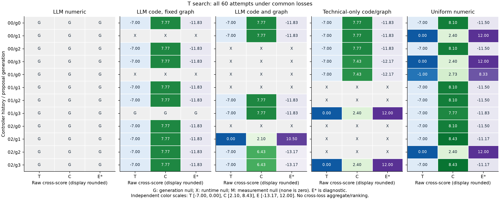
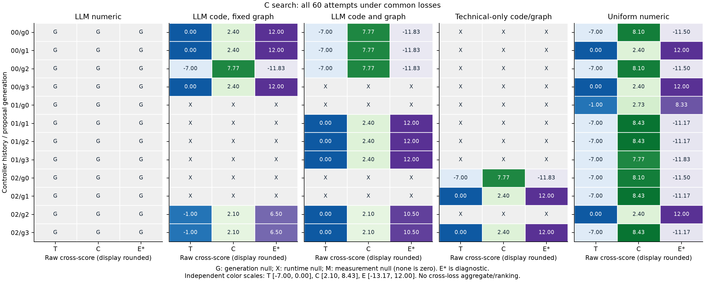
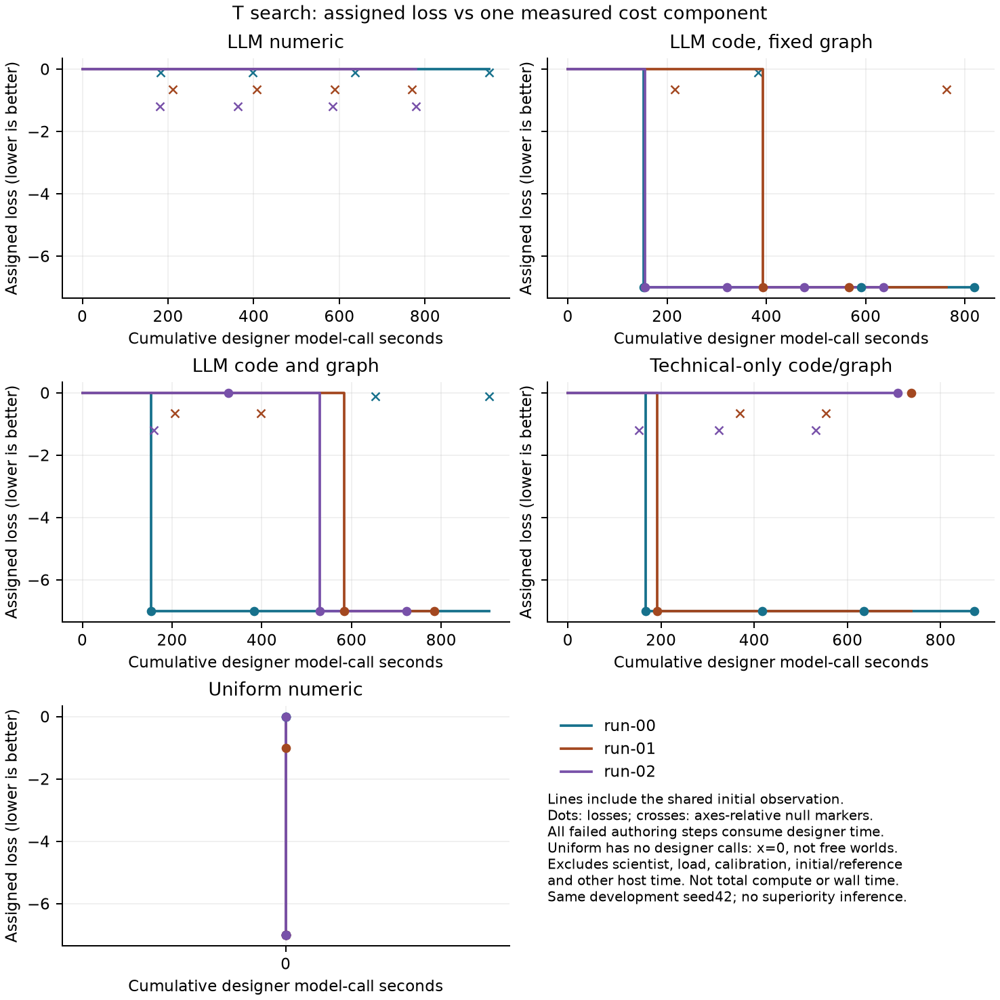
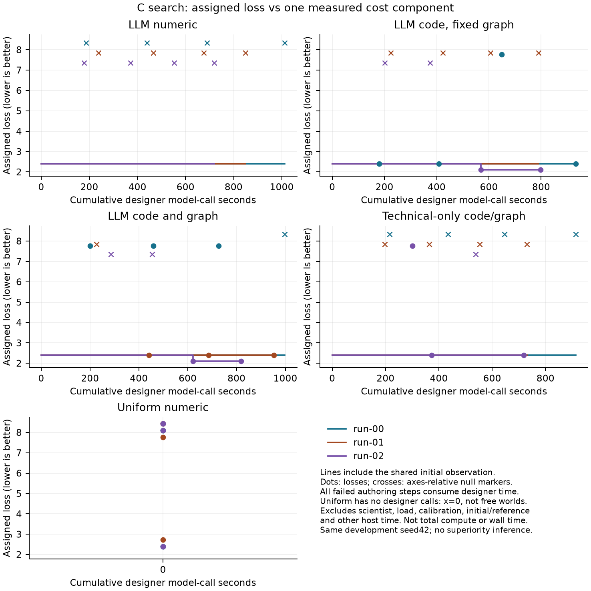
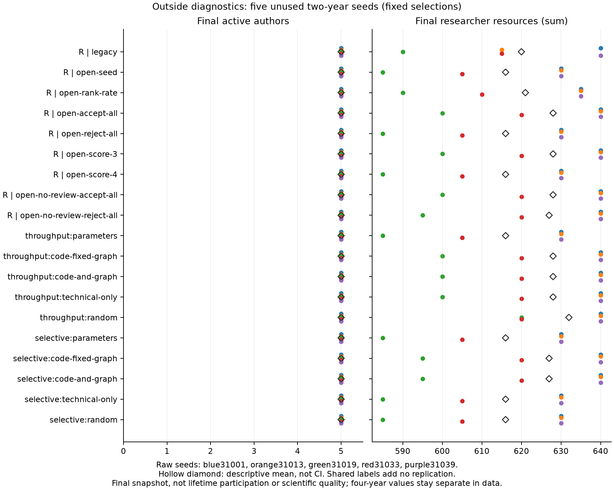

# Completed V2 supplemental analysis

2026-11-08. Actual closed-study observations, not SCRIPTED QA or another model
experiment. [Machine data/figures](../../paper/generated/native-design-v2-supplement/manifest.json)
bind all120 attempts,30 history/method cells,90 unique evaluation jobs and38
label/horizon outside-metric summaries to the same closed audit. The exact
auxiliary/scientist cost projections are retained as two compressed inputs;
the source report archive and selection remain unchanged.

## All candidates under common losses

The two matrices include every60-slot objective cohort, all three controller
histories and all four generations. Each loss has its own fixed color range;
display rounding never enters selection. Grey G/X cells are generation/runtime
nulls, not numerical zero or a large penalty. E is diagnostic, not a newly
introduced search objective. Full-precision values and missing metrics are in
the all-search-observations CSV and supplement JSON.

A T code/graph candidate has a favorable observed diagnostic E of approximately
-13.17 at development seed42. It was not selected by E or evaluated as an
E-optimized policy: E was never an active arm. Fresh researcher replies are not
perfectly coupled even for equal policies, so this cross-score does not prove
a policy/algorithmic gain. Neither failed candidates nor all exact ties are
removed. Three controller histories are still one development world condition.

## Search costs by method

| Objective / method | Complete /12 | Designer requests | Designer host seconds | Recorded scientist replies | World directories |
| --- | ---: | ---: | ---: | ---: | ---: |
| T / LLM numeric | 0 | 192 | 2497.2 | 0 | 0 |
| T / LLM code / fixed graph | 9 | 172 | 2219.1 | 859 | 11 |
| T / LLM code + graph | 7 | 168 | 2413.4 | 739 | 12 |
| T / Technical-only | 7 | 168 | 2318.9 | 745 | 12 |
| T / Uniform numeric | 12 | 0 | 0.0 | 1097 | 12 |
| C / LLM numeric | 0 | 192 | 2580.9 | 0 | 0 |
| C / LLM code / fixed graph | 6 | 168 | 2519.7 | 682 | 12 |
| C / LLM code + graph | 8 | 167 | 2770.8 | 826 | 12 |
| C / Technical-only | 3 | 160 | 2361.9 | 459 | 12 |
| C / Uniform numeric | 12 | 0 | 0.0 | 1107 | 12 |

Rows pool three four-proposal histories, not three independent environments.
These are **search-only components**. They exclude reference/initial worlds,
calibration, role loads, held-out evaluation, retrieval, other host work and
earlier development. Designer host-call time is not provider duration, GPU time
or end-to-end wall time. Native replies include partial-world replies. A zero
recorded native count in numeric LLM arms does not imply free authoring or no
model-load cost. A provider final-response signal is not a successful final
candidate submission:1387 proposal requests have1385 final signals.

The120 slots contain95 recorded world directories:64 completed worlds and31
execution-null partial worlds;25 generation-null slots never dispatch a world.
Search records6514 scientist replies and640 institution-code executions.
Adding the9 fresh references and90 evaluations gives194 physical journals/
world directories, not194 completed scientific observations. There are163
completed forwards, matching the fixed-record analysis. Identical policies or
logical labels are not deduplicated into cheaper search histories.

All designer host-call seconds are known here and total19681.867535932688.
Native completed-world model seconds are explicitly labelled completed-only;
partial-world timing is not inferred from them. Scientist token totals/cache
subsets are separate per-history CSV/JSON fields; absent usage groups stay null,
not imputed zero tokens. No component times are added into a supposed project
total.293 role loads still have unknown native usage. Overall writer wall time
is78958.697204 seconds; it cannot be retrospectively allocated into precise
end-to-end per-trial wall-time curves from these projections.

The x-axis charges **designer model-call time only**, including failed steps.
Uniform proposals are at x=0 because no designer is called, not because their
world evaluations are free. Shared initial observations are shown at zero added
search author time; their own costs and calibration are excluded, not erased.
Generation-budget paths remain in the main paper. The measured-component curves
do not establish equal-compute or equal-wall-time superiority. Missing timing
would stop the cumulative numeric axis rather than become zero.

## Outside activity and resource diagnostics

All90 unique evaluation jobs, including the separate four-year diagnostic,
have final_active_authors=5. All64 complete development candidates also end
with5. Thus this final snapshot provides no observed separation here; it does
not show that institutions cannot affect careers or that lifetime participation
is equal. Additional custom institutional actors are not counted as original
researchers. Five colored two-year points are the fixed unused seeds; hollow
diamonds are descriptive means, not confidence intervals or expected values.

At two years, final summed researcher resources average620 for legacy,616 for
the editable seed,628 for hand-written accept-all and the three executable T
LLM/control selections,632 for T uniform, and627 for both C code selections
and reviewer-free reject-all. Raw ranges overlap: e.g. initial585–630,
C code595–640 and T uniform620–640. Four-year values are separate single
observations (e.g. initial720, C code780, T uniform760), not extra replicates.

These are endogenous simulator resource snapshots, not money, scientific
truth, equity, welfare or an additional optimization objective. No resource/
participation threshold or hidden promotion veto is introduced. The same policy/
seed may realize different fresh replies, and no isolated intervention on the
source of these resource differences is performed; do not call the differences
causal institutional benefits. All eight native metrics, original A/Q/R,
rejections, unreviewed acceptances and context deliveries remain in the raw
physical-job table/JSON, with exact shared job IDs.

## Rebuild and interpretation boundary

From a clean committed checkout, using the existing approved project interpreter:

    python -m scripts.reports.native_design_supplement --output <fresh-directory>

This verifies exact archives/source/audit bindings, recomputes the table joins,
regenerates four CSVs and five PNG/SVG figure pairs, and preserves full-precision
machine data. The62-check batch and actual run are recorded separately; tests
are not new worlds. Initial render wording/axis changes affect presentation
only; numerical supplement bytes are identical across both render iterations.

No new inference, generated institutional source execution, objective, seed,
candidate, selection or causal experiment is added. This closes the named
cross-score/cost/outside-metric presentation gap; it does not supply optimizer
superiority, structural invention, independent validation, real-policy benefit
or a stronger novelty claim. The mock review and final submission judgment must
be assessed under that unchanged boundary.
