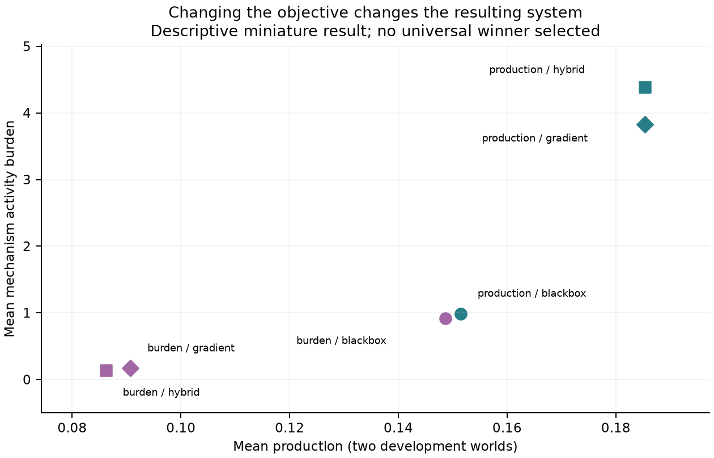
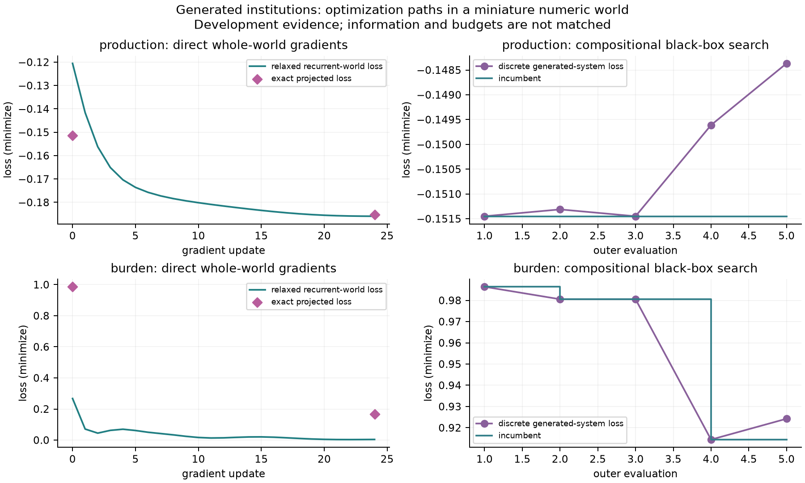

# Generative Program World v1: recorded miniature result

Date: 2026-10-31

Source revision: `c035d1da793d` (full revision in the compact JSON record).
The source was clean and ran in an isolated detached experiment worktree.

Protocol: [development protocol](../protocols/campaigns/generative-program-world-v1.md)

Implementation: [mechanism programs and numeric world](../components/generative-program-world-v1.md)

Compact evidence: [result JSON](generative-program-world-v1.json)

## What actually ran

A local `qwen3:8b` request generated a new custom mechanism, its executable
numeric rule, world effects, and six researchers' initial attributes. The
response validated on its first attempt. That proposal was then frozen and
combined with a second seeded development world. Each system ran for three
periods. Production and burden were optimized separately with five black-box
proposals, 24 direct gradient updates and a five-proposal discrete hybrid.

Qwen called its mechanism **SignalBoost**. Its actual output rule is:

```text
output = tanh(quality * gain + incoming_signal * bias)
memory_next = tanh(memory + 0.3 * novelty)
```

It has allocation, access, learning and effort effects. Its rationale mentions
quality and novelty; the actual output reads quality and incoming signal.
Novelty only enters a memory update whose value is not read by this output.
This concrete mismatch is retained: generated prose is not used as evidence
of what an institution computes. The executable AST and traces are the
authoritative description.

Both the black-box generator and hybrid also synthesized additional programs
and custom nodes directly from the numeric grammar. The production hybrid's
selected system includes a sixth newly generated node, `commons-2a5b5849`.
The eight explicit mutation operators were separately executed as interface
checks, including node removal, new rules, edge changes, delays and order.

## Objective-conditioned outcomes

The following values are means over the same two **development** worlds.
Losses minimize negative production or positive burden, respectively.

| Selected under / method | Production | Activity burden | Nodes | Edges |
|---|---:|---:|---:|---:|
| initial system | 0.151450 | 0.986401 | 5 | 5 |
| production / black box | 0.151450 | 0.986401 | 5 | 5 |
| production / gradient projection | 0.185334 | 3.824426 | 5 | 5 |
| production / hybrid | 0.185375 | 4.385414 | 6 | 6 |
| burden / black box | 0.148605 | 0.914423 | 5 | 7 |
| burden / gradient projection | 0.090712 | 0.166948 | 4 | 3 |
| burden / hybrid | 0.086178 | 0.137721 | 4 | 3 |

The production objective retains the original five institutional nodes in the
gradient projection. The burden objective removes the funding node and changes
the execution order to evaluation → research → publication → SignalBoost.
The burden hybrid subsequently changes that order again. A shared evaluation
of both objectives exposes the trade-off rather than declaring a universal
best system. No fairness floor or promotion veto is imposed.



These values describe the declared miniature equations. In particular,
"burden" is squared numeric mechanism activity, not empirically measured
researcher administration time. Its economic/social interpretation requires
future measurement work.

## Gradients and discrete projection

Both arms passed the representative whole-rollout central-difference checks
for all six variable groups: parameters, rule choice, node presence, edge
presence, delay and schedule. The maximum absolute discrepancy across the
twelve group representatives was `1.3834e-11`. This checks representative
coordinates per group, not every coordinate of every program.

Production's signed relaxed-to-discrete loss gap was `0.0006065`. Burden's gap
was much larger, `0.163754`. Although both final discrete losses improved over
their initial discrete systems in this run, the burden example shows that a
low relaxed loss need not survive projection. This gap is retained rather
than reporting only the attractive inner-loop value.



The gradient path receives derivatives of the numeric simulation while black
box sees scalar results. Budgets and information are not matched. The figure
therefore supports execution and path inspection, not optimizer superiority.

## Runtime and reproducibility

- Clean recorded numeric-only run: 2.625 seconds.
- Recorded Qwen proposal + complete numeric lab: 16.458 seconds.
- Local Qwen request: 12.995 seconds, 423 prompt tokens and 553 generated tokens.
- Re-execution from the frozen Qwen proposal: 3.289 seconds.
- Frozen-input reproduction matched worlds, program banks, selected systems,
  proposal lineage, complete losses/metrics, gradient traces, trajectories and
  mutation checks exactly. Wall-clock and timestamp fields were excluded.
- Every selected discrete system's loss was independently recomputed from its
  saved programs, initial worlds and ordinary LossSpec.

This runtime belongs to the new small numeric backend. It does not estimate
the cost of the original longitudinal Qwen simulation.

The compact frozen proposal is committed at
[`generative-program-world-v1-qwen.proposal.json`](../artifacts/generative-program-world-v1-qwen.proposal.json).
Raw response and report hashes/locators are in the compact result. The recorded
commit is retained by the detached experiment worktree. Reproduce its numeric
experiment without another model query from that source revision:

```bash
CUDA_VISIBLE_DEVICES='' PYTHONHASHSEED=42 /path/to/venv/bin/python \
  scripts/run_generative_lab.py \
  --proposal-input /path/to/generative-program-world-v1-qwen.proposal.json \
  --output outputs/reproduction
```

## Game/evidence verification

The new `generative.html` view loaded the recorded checksum-bound payload.
Real Chrome verification confirmed two objective arms, four selected-system
views per arm, six researcher state displays, node/rule selection, switching
to period three, and a responsive mobile layout without overflow. Browser
exceptions and failed requests were both zero. The authoritative numeric
trajectories and canonical events are exported by Python; the browser only
renders them. Loss is aggregated over all development worlds, while the
trajectory and metric profile display one explicitly identified world.

## Remaining project gaps

The new backend now generates and executes new bounded numeric institutions,
changes their graph/process, and differentiates the complete *relaxed numeric*
world. Its operator vocabulary, observations and world-effect channels remain
fixed. It does not invent arbitrary source code or new physical laws.

Qwen token generation is frozen outside autograd. Arbitrary generated
institutions are not yet connected to the full legacy manuscript/reviewer/
funding/LLM-agent simulation. A richer typed artifact language, native legacy
integration, learned models of original-simulator dynamics, and a playable
intervention interface in the city remain subsequent work. The original
Miniature Whole-System Design Lab integration milestone is therefore still
partial, even though this numeric generation/differentiation slice is complete.
