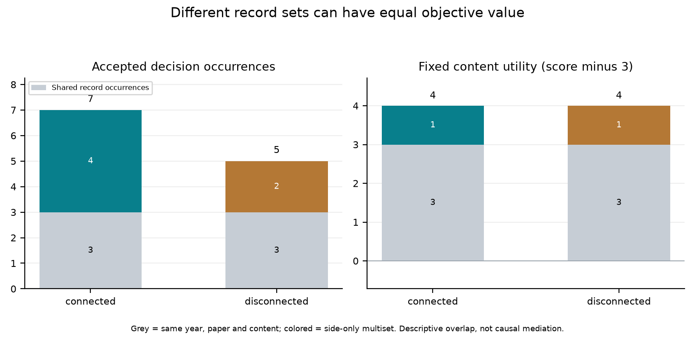

# Equal content utility despite different accepted records

In the first objective study's audited developer references, the connected
liquidity system records seven accepted decisions and the disconnected system
five. Their fixed content utilities both equal four. The accepted records are
not a shared five-paper set plus two extra papers: three occurrences are shared,
four occur only in the connected world and two only in the disconnected world.

| Observed record group | Accepted occurrences | Sum of fixed score minus 3 |
| --- | ---: | ---: |
| Shared between the two worlds | 3 | 3 |
| Connected world only | 4 | 1 |
| Disconnected world only | 2 | 1 |

An occurrence is matched by year, paper identity and exact content identity;
repeated occurrences retain their multiplicity. The side-only groups are
observed multiset differences, not an identification of papers causally created
or prevented by transfers. The systems differ only in their connection list,
but this one reused seed does not identify a general effect or causal mediation.

The score sums are25 and19. Therefore the connected-minus-disconnected count
loss is `−(7−5)=−2`, while the declared content loss difference is
`−[(25−3×7)−(19−3×5)]=0`. The three connected-only score3 occurrences and
one score4 occurrence contribute one utility unit; the disconnected-only
score3 and score4 occurrences also contribute one. Score3 is neutral under
this declared preference, not evidence that the paper is bad science.

Holding these realized records fixed, a hypothetical score center c would give
the utility difference `6−2c`, with indifference at c=3. This conditional
arithmetic explains the current tie; it is not a new objective, an optimization
over c, an adapted institution or a reason to change the active study's loss.
The abstract-based fixed-model ratings remain opinions, not independent
scientific truth. Shared cached content is not an independent rating replicate.

## Evidence and research boundary

Two byte-identical original-source audits validate the reference measurements
at scientific537514a. That study later stops at an outer replay budget bug,
before any candidate world. This result neither completes it nor adopts its
unexecuted submitted definition. Reader8b675cf checks the full raw inventory,
matches literal reference observations to audited systems and scores, then
exports all records and the figure twice. All four output files agree; the
actual PNG is visually inspected. [Data, hashes and rebuilding](../data/native-content-overlap-v1/README.md).

The separate corrected61a1753 optimization continues unchanged. This analysis
explains an observed objective tie and supplies a descriptive decomposition;
it does not demonstrate newly invented mechanisms or close publication
milestoneR2. The next empirical interpretation must use the completed actual
proposal paths and selection-frozen evaluation, not mistake higher counts,
identical totals or changed source text for all-purpose scientific improvement.
