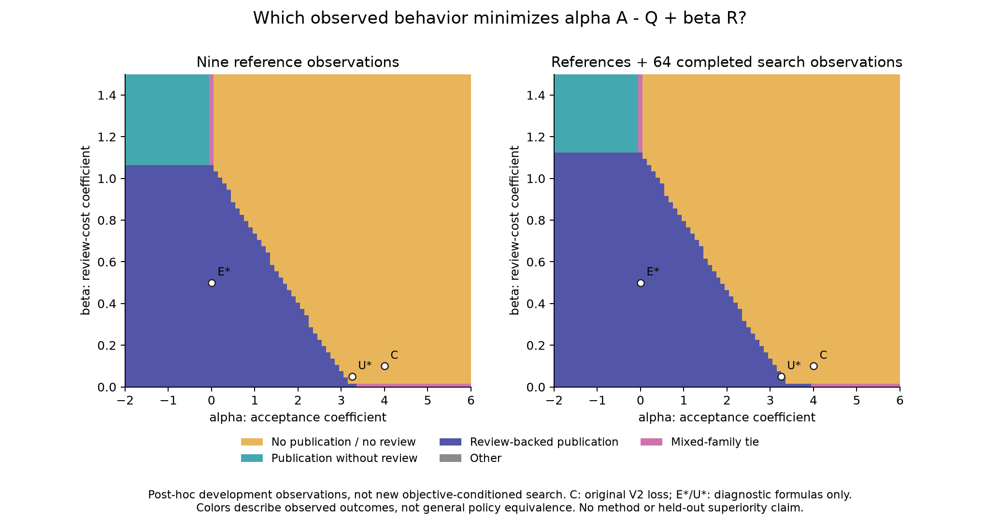

# 保存済み制度の目的関数と提出失敗の追加分析

2026年11月8日。V2の凍結済みreport projectionを使った事後分析。
新しい研究者応答、制度の実行、設計者呼出は0。新しい最適化実験やraw再監査ではない。

## 結論

現在の結果が弱い理由を、単に探索規模やモデルサイズへ帰属することはできない。
目的の代数的な誘因、設計空間に合わない提出、同じ制度の実行間の違いが、それぞれ関係する。
次の実験はこれらを分離し、目的別に何を選ぶかと、制度の変更が何をしたかを調べる。

## 入力と再計算

- 元実験source：`b6654adefc42223f9ecc7b4e53c043c879230f68`。
- 閉report content：`75f64370d673699553f69c480c93b90c07c2babba70b4f924cbc54438ab9d732`。
- 元audit content：`eb305ac09bc46d68d53b632674095966f3ae9be1307629d450196ec4519b8b45`。
- [実行コード](../../scripts/reports/native_design_objective_landscape.py)、[検証](../../tests/reports/test_native_objective_landscape.py)。
- [数値](../analysis/native-design-objective-landscape-v1/analysis.json)、[入出力manifest](../analysis/native-design-objective-landscape-v1/manifest.json)。
- analysis content：`0efa6194154fe186ce58cc12f5fd459f995c288403af3e14b78686b593c7a4a5`。

64完走候補のA・Q・Rを保存済みmeasurementから読む。25生成失敗と31実行失敗は数値へ補完しない。
9参照について、このprojectionに含まれるのはT・C・Eであり、A・Q・Rはその独立な三式を反転して求めた。
これは新たにraw measurementを読んだことではない。整数countの復元と小さな浮動小数点残差を別記し、元のscoreと選択は変更しない。

## 目的の重みを変えたときの既知の選択

`L = alpha A - Q + beta R` を最小化する既知の観測を描いた。
Aは採択decision数、Qは採択decisionの元review平均の総和、Rはreview record数。

左は9参照、右は参照と64完走候補。各領域は、保存された個々の観測で最小になる挙動を表す。
81×51の係数格子は描画の指定であり、独立標本数でも、目的が選ばれる確率でもない。
同じ挙動色は、一般的なpolicy同値性を意味しない。

### Cが採択しない制度を選ぶことには代数的な理由がある

Cは `4A-Q+0.1R`。保存された最良のreview付き全採択型profileはA=7、Q=23.666666666666668、R=21。
そのprofileの損失は、alpha=4、beta=0.1で約6.4333。
reviewなし・採択なしの参照は0なので、Cではそちらが良い。
search候補の最小2.1も、この参照の0を超えない。

この全採択型profileと0の切替は、固定beta=0.1でalpha約3.08095。
beta=0.05では約3.23095、beta=0.5では約1.88095となる。
これは既知の観測同士の線形比較であって、未知の制度、将来のreview、動的policyまで含む最適性証明ではない。
「最適化が止まったから全却下しか出ない」と決めつけず、目的そのものがその答えを評価する領域を確認できる。
この目的を後から無効にしたり、全却下を隠れた条件で落としたりしない。

### 診断Eの最良観測はあるがE最適化の成功ではない

E=`-Q+0.5R` では、上記profileの値は約-13.1667で、全採択参照の約-11.8333より低い。
該当するのは `run-02:throughput:code-and-graph:g2/g3` の二観測。
これらはthroughput探索の候補で、Eを目的として発見・固定した制度ではない。
新しくEの勝者を選んだことを、既存held-out評価済みの制度や手法優位性へ置き換えない。
差はfresh応答や事後の最大値選択でも生じうるため、制度の効果の検証が別途必要である。

## 同じ制度でも観測は完全には一致しない

完走候補をsystem fingerprintで束ねると、同じfingerprintでQが約1/3違う組が二組ある。
別の一組の約3.6e-15の違いは、analysis tolerance内の浮動小数点差として区別した。
実質差の二組はuniform数値候補の別目的armでの実行にあり、同じ開発world seed42を使っている。

この事実だけで差の原因を全て推論ノイズと特定したわけではない。
少なくとも、同じ制度とseedだからfresh LLM実行が完全な反実仮想ペアになるという前提は置けない。
次の機構比較では、介入前の全入力と履歴の一致、介入後のfresh応答、実行間の変動を分ける。

## 数値案の失敗は提出を試みなかっただけではない

24数値候補の記録済み384ステップを集計した。全24件の終了理由は
`step budget exhausted without valid explicit finish`。
ただし、その内部には47回のfinish試行があり、すべて却下されている。

| finishの却下理由 | 件数 |
| --- | ---: |
| 宣言されたparameters設計空間を超えるcandidate | 43 |
| 宣言されたcoordinateの数値範囲外 | 4 |

read_fileは228回で、そのうち166回は `code/world.selection.py` を対象とする。
編集しても最後に数値専用domainに合わず落ちる経路があり、一般的なコード編集の誘導とdomain遵守を区別して診断する必要がある。
47回の提出却下は47件の独立した科学実験ではなく、24候補の内部stepである。
一つのinvalid-response stepにはtransition error listがなく、不明なものを空listと同一視していない。

これでモデルの理解、promptの誘導、編集APIの使いやすさの単一原因が確定したわけではない。
次は数値を直接指定する提出経路との有限比較を行い、元の候補や失敗を修理・補充しない。

## 費用について分かった範囲

64完走development worldの保存済み研究者model-call時間成分は、最小約253.0秒、中央値約286.0秒、最大約435.4秒、合計約19,314.5秒。
二年worldの**モデル呼出成分だけ**であり、設計者、失敗、load、container、retrieval、その他host時間を除く。
この中央値をそのまま四年worldのwall timeや次実験の納期に使わない。
従来のwriter全体約21時間56分とも範囲が違う。

## 次の研究設計への帰結

1. Cなどの単純な答えを残しつつ、目的別にどの制度が選ばれるかを研究する。
2. code/graphに許可があるだけでなく、実際の情報経路・状態・配分が使われる比較を作る。
3. 数値の提出経路を分離した診断で、自由度と提出能力の交絡を小さくする。
4. 同じ制度の再実行変動を考慮し、変更traceだけで因果的な改善としない。
5. 既存の重みを見て選び直した結果は探索的解析として保存し、次の目的・選択・評価を前向きに固定する。

[具体的な小規模実験案](../protocols/campaigns/objective-system-mechanisms-pilot-draft.md)と
[研究全体の判断計画](../publication/research-questions-and-decisions.md)へ反映する。
