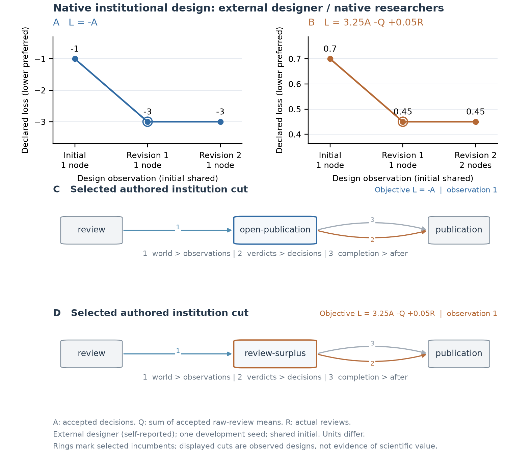

# Two objectives, authored institutions and actual native feedback

Completed2026-11-01. [Preregistered scope](../protocols/campaigns/native-external-objectives-v5.md),
[independent machine-readable audit](native-external-objectives-v5-a1.json).

## What completed

The entire declared budget completes from clean source
`019b90bd394480414579b3ff41059bb12bd6036b`: one common initial physical world
and two adaptive native worlds per objective, five physical worlds/six logical
observations. Each world contains five original researchers, two simulated years,
development seed1301, the same four-year corpus and fixed local Qwen3:8b.
There are285 actual researcher responses,57 per physical world. No numerical
miniature replaces original research, retrieval, funding or publication phases.

The institution designer is the separately labelled Codex specialist
`/root/joint_region_v5`, not Qwen. It reads exact frozen requests and writes
complete code/protocol/graph manifests, including all wires and ordering.
Initial host policy source is withheld; root inserts no institutional code or
missing semantic wire. Actual losses, measurements and exact generated systems
condition the second proposal. The specialist is not blinded across objectives.
Author identity is self-reported, not authenticated provider provenance. No
additional paid provider API is called by this adapter. Earlier local-Qwen
generation failures remain separate, not silently extended or overwritten.

## Paths and systems

| Objective minimized | Actual loss path | Editable-cut node counts | First selected authored system |
| --- | --- | --- | --- |
| `-A` | `[-1,-3,-3]` | `[1,1,1]` | Open publication: accept every actual submission |
| `3.25*A-Q+.05*R` | `[.70,.45,.45]` | `[1,1,2]` | Review surplus: accept only if actual review mean exceeds3.25 |

A is actual accepted review-history decisions; Q sums their actual raw reviewer
means, never generated final scores; R is actual reviews. All observed review
means are3. Thus throughput selects three acceptances and utility selects zero.
Neither outcome is a discovery of scientifically good policy. The3.25 charge
was intentionally informed by earlier development scores3 before this pilot;
the contrast is an illustrative engineering preference, not a blind normative
or scientific trade-off discovery. No fairness/participation/quality veto is added.

The final throughput revision removes unused review aggregation and uses a
procedural approval score, without manufacturing Q. The final utility revision
introduces a genuine two-stage protocol: a review-pricing producer computes
per-paper publication-loss offers; a clearing consumer commits native decisions
and the completion signal. Both Python nodes execute twice in the fresh world.
Its expected and actual loss tie the one-node incumbent; this is structural
exploration, not structural superiority. The deterministic first-best tie rule
keeps revision1 selected in both arms. Full SystemSpecs for ALL observations,
including the nonselected two-node revision, are retained in`observed_systems`.

| Completed development world | A | Q | R | Throughput loss | Utility loss |
| --- | ---: | ---: | ---: | ---: | ---: |
| Common initial | 1 | 3 | 9 | -1 | .70 |
| Selected throughput design | 3 | 9 | 9 | -3 | 1.20 |
| Selected utility design | 0 | 0 | 9 | 0 | .45 |

Cross-scoring reuses these SAME development worlds. It is not held-out
evaluation, independent replication or uncertainty evidence. The editable
selection cut is downstream of review; R remains9 and cannot be optimized away
by pretending already-incurred reviews did not occur. Final active authors and
total resources remain5 and640 in all observed worlds; this pilot does not show
changed longer-term researcher behavior or broad welfare effects.

## Independent checks and time

The read-only analyzer reconstructs each exact external request, response,
manifest, prompt/history/repair binding, compiled patch and saved chronological
probe route. It verifies actual executed source/image events and native
checkpoints, independently re-extracts all eight measurements and cross-loss
scores, checks every researcher response journal, and validates common-initial
adoption. It starts no model calls and executes no generated Python. All97 raw
files remain byte-identical before/after analysis. Provider authorship is not
inferred from a nonexistent Qwen-designer cache.

Native run-manifest durations are244.12s(initial),265.88s(throughput1),
205.46s(utility1),279.45s(throughput2) and205.58s(utility2), about20.0minutes
summed native-driver time. These are3.4–4.7minutes per world on this machine,
including setup/recording, not pure token throughput or a GPU speed prediction.
The roughly32-minute first-start-to-last-finish interval also includes external
authoring, durable waiting and orchestration; those costs must not be hidden.

## What this establishes, and what remains

This closes the small original-world loop
`explicit loss -> authored code/graph -> actual result -> feedback revision` for
two competing objectives. It does not establish algorithmic novelty, useful
scientific institution invention, an optimum, held-out generalization or method
superiority. The larger scientific system has NOT been freely optimized.
This pilot edits one native selection cut; the general authoring region still
has a bounded zero-delay DAG and requires recorded boundary contexts. Additional
activity/actor semantics and hidden annual dependencies remain implementation
gaps. The new resource-transfer capability is separately scripted-native-tested,
not exercised by these five earlier pinned live worlds. Whole-world pathwise
backpropagation, automatic same-society adoption and recursive designer
improvement remain separate goals, not consequences of these results.
