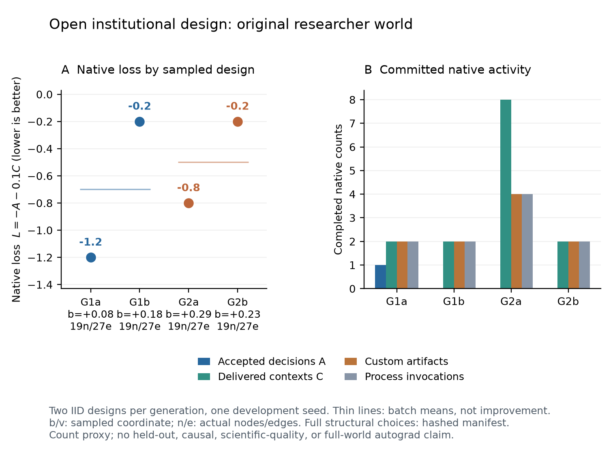

# Integrated open-native v7 — completed engineering pilot

2026-11-02. [Independent machine-readable audit](native-open-integrated-v7-a2.json),
[preregistered scope](../protocols/campaigns/native-open-integrated-v7.md),
[implementation inventory](../milestones/2026-11-02-non-scale-implementation-closure-v7.md).

## What actually ran

Frozen clean source `c09e069f6e1fd8d7376a509c71fa462ae339f3c1`, fixed local
Qwen3:8B researchers, four reset original-native worlds with five authoring
researchers each, two years, one development seed42 and the original four-year
corpus.342 actual HTTP/cache responses complete. Two external Codex-authored
generations adapt a transparent developer seed from actual loss/source/review
feedback. Self-reported author identity is not provider authentication or
autonomous Qwen source invention. No paid API or held-out evaluation is added.

The loss is explicitly `L=-A-0.1C`: native accepted decisions A and actual
context-delivery events C. This is a gameable engineering count objective, not
scientific value. No unrequested merit/fairness/participation veto is applied.

| Draw | Generation | Process | A | C | Loss | Artifacts / invocations |
|---|---|---|---|---|---|---|
|1|0|focused|1|2|-1.2|2 /2|
|2|0|focused|0|2|-0.2|2 /2|
|3|1|reciprocal|0|8|-0.8|4 /4|
|4|1|focused|0|2|-0.2|2 /2|

The first source creates a persistent evidence clinic, actual-paper-linked
falsification/negative-control records and original researcher inputs/projects.
Generation1 keeps native topic choice when papers do not yet exist, then uses
actual review criticism to build revision and negative-control briefs. New
source really executes. The third new review-response process option is valid
but unsampled; IID draws are never rerolled to force diversity. All graphs stay
19 nodes/27 edges: source algorithms, process repetition, recipient relations
and continuous parameters change, not graph size in this live probe.

The Gaussian latent mean moves
`0 → -0.02205732321823871 → -0.014899631103323116`; categorical gradients are
`[0,0]` then `[.3,-.3,0]`. Both designer-strategy draws select `revise`, with
actual-loss statistics and weights updated. Batch means worsen `-.7 → -.5`;
best loss remains-1.2. **No optimization improvement is established.**

## Independent evidence and boundaries

All67 raw files remain unchanged before/after audit.26 physical code executions
uniquely match input bundles, committed events and durable memory. Each world
retains one custom cooperative over two years and starts from the same physical
society.14 recipient-state context receipts exist; only12 match verbatim text in
completed model inputs. Receipt delivery is not evidence that all14 were used.
Native funding parse retries stay in the evidence, not hidden objective penalties.

Four conditional numerical/backward checks pass through represented tensor
operations, not the joint native LossSpec, source synthesis or opaque researcher
responses. Native projection/fresh-reaction/fidelity/restart is separately
implemented and tested with scripted responses in the original six-year world;
that native-fidelity comparison fails and remains a negative result. No fresh
real-Qwen derivative-fidelity experiment is implied.

No causal benefit, scientific-quality gain, useful institutional discovery,
designer improvement, held-out superiority or full-world pathwise derivative is
claimed. This establishes an executable original-world feedback loop across
open entities/processes/source generation/mixed search, not research success.

## Files and reuse

The immutable local raw run is
`/Users/shiro/unktok/dev/science-utopia-lab-experiments/native-open-integrated-v7-a2/outputs/native-open-integrated-v7`.
Prepared a1 has zero native worlds/replies and is not an extra scientific trial.
Audit source hashes are recorded in the report, not silently changed to the
current integration revision. The UI export is byte-identical to that report.
[Verification receipt](non-scale-closure-v7-verification.json) keeps separate
source-bound full/targeted/UI/PDF checks, whose overlapping counts are not added.

