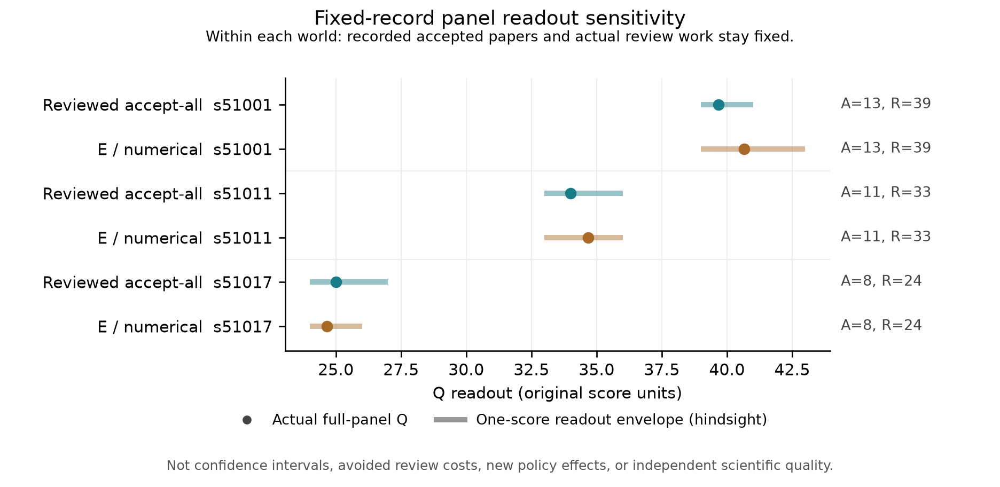

# 記録済み査読panelの読出し感度

2026年11月11日。Qは制度が選んだ査読者の得点から作るため、科学的品質から独立した測定ではない。
閉鎖済みT/E研究の記録で、採択集合と実際の査読費用を固定したまま、記録済みpanelの一部を
読む場合の感度を計算した。新しい制度、査読者割当て、世界や損失改善を測った実験ではない。

## 対象と計算

元研究sourceは62388a7、full-audit contentは85d4698f。49 physical worldのうち、
四年を完了した44世界のcheckpointを用い、5つの途中失敗は完了値として補充しない。
各世界の元A/Q/Rをcheckpointから再計算し、元full auditの測定値との一致を要求した。
さらに全1,859 raw fileのinventoryと原sourceのclosureを照合した。

各採択decisionの元score列について、サイズkの全subsetの平均を列挙する。
図はk=1の最小・最大を世界内で合計した範囲と、元の全panel平均によるQを描く。
元の採否、論文、応答、査読仕事Rは変えない。したがって、既に行った査読を費用から引かない。
査読のない採択は元の測定どおりQへ0を寄与し、仮の品質を補わない。

一様にsubsetを選ぶと、その読出し平均の期待値は元panel平均と一致する。
大きい端点を達成する選択は観測後のhindsightを使う場合があり、実行可能な事前制度の最適値ではない。
subsetを独立な科学worldや評価seedとして数えない。

## 結果

44完了世界には、査読付きの採択decision217件、査読なし46件がある。
24世界でk=1読出しのQ範囲が非零だった。これは相関した既存記録の件数であり、
新しい母集団に対する割合推定ではない。同一artifactやpolicyの反復を独立論文とは扱わない。

以前のE/numerical対reviewed accept-allの比較を例に、全三seedの記録を示す。
各行は、その世界自身の採択集合を固定する。行間で論文や応答まで同一とは仮定しない。

| 元の選択後seed | 制度 | A | 実R | 元のQ | k=1読出し範囲 |
| --- | --- | --- | --- | --- | --- |
| 51001 | Reviewed accept-all | 13 | 39 | 39.667 | 39–41 |
| 51001 | E/numerical | 13 | 39 | 40.667 | 39–43 |
| 51011 | Reviewed accept-all | 11 | 33 | 34.000 | 33–36 |
| 51011 | E/numerical | 11 | 33 | 34.667 | 33–36 |
| 51017 | Reviewed accept-all | 8 | 24 | 25.000 | 24–27 |
| 51017 | E/numerical | 8 | 24 | 24.667 | 24–26 |

棒は信頼区間ではなく、条件付き読出しの範囲である。幅が元の制度間差より大きくても、
その差がpanel操作で起きたとは言えず、元の比較や有効性を取り消す根拠にもならない。
図は得点の解釈を限定するための診断であり、独立品質、実際の査読削減、因果効果を示さない。

## 次の実験への含意

現在実行中のrouting-v2 pilotは、宣言したT/Eのまま完了させる。
この分析を新しい採用条件やnormative vetoとして追加しない。

制度がpanelを選べる条件で外側の品質を比較するなら、制度から独立した固定observerを
別に宣言する必要がある。既存の同一LLMによるblind abstract採点なら、検証できるのは
別条件の意見であって科学的真偽ではない。真偽を問う研究活動の拡張は別の課題である。
どちらもこの読出し診断から実証済みとは扱わない。

## 再構築

[全データと原sourceの検証情報](../data/native-panel-sensitivity-v1/report.json)のcontent SHA256は
`73d3df0c0bd0e0183775cb0cfd12dc0585cf0904fdb48294b3caf758eeb6aa6d`。
二回の原source読出しと、保持した三回目の出力はbyte-identical。
PNG/SVGも二回一致し、上図のPNGを目視確認した。15件の計算・physical joinテストがpass。

`scripts.reports.native_panel_sensitivity_v1`は元のclean62388a7を別interpreterで読み、
raw full auditと全checkpointを照合する。`scripts.figures.native_panel_sensitivity_v1`は
その結果と元auditのlabel/seed/physical jobを結合する。独立品質や新しい科学worldを作らない。
旧44ページPDFと、進行中の671436a sourceは変更していない。
