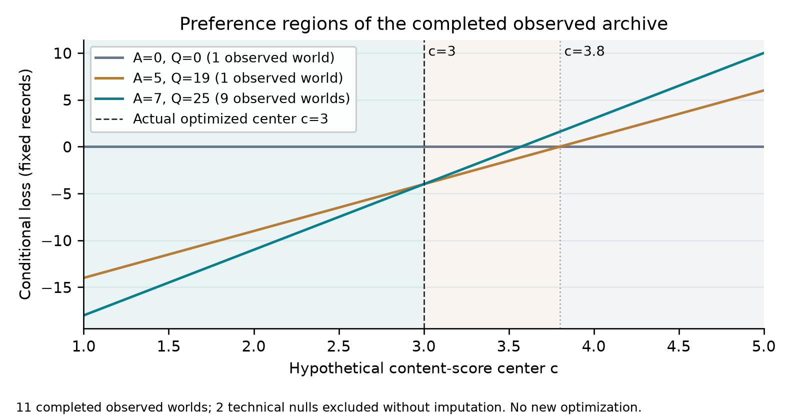

# Conditional preference regions of the observed native archive

Among the11 completed worlds in the closed T/U development, the current
content-score center3 lies exactly on a boundary: the connected accept-all
worlds and disconnected accept-all world both have loss−4. This tie is compatible
with different accepted records and counts, not proof of identical behavior or
of an optimizer defect.

The complete observed score bank has three distinct `(A,Q)` vectors, where
A is accepted occurrences and Q is the sum of their fixed three-position mean
scores. Nine completed worlds have `(7,25)`, one has `(5,19)` and one has `(0,0)`.
The two technical-null attempts remain listed separately with no assigned loss.
These11 worlds are not independent optimization replications.

For explanation only, hold all realized records, trajectories and ratings fixed
and evaluate the hypothetical family

`L_c = U_3 + (c−3)A = cA−Q`.

| Hypothetical center | Lowest-loss observed score vector | Observed-world membership |
| --- | --- | --- |
| 1≤c<3 | `(7,25)` | Nine worlds, including six completed proposals and three connected controls |
| c=3, the actual optimized center | `(7,25)` and `(5,19)` tie | Ten completed worlds |
| 3<c<19/5 | `(5,19)` | Disconnected reviewed accept-all control |
| c=19/5 | `(5,19)` and `(0,0)` tie | Disconnected accept-all and connected reject-all controls |
| 19/5<c≤5 | `(0,0)` | Connected no-review reject-all control |

The connected/disconnected lines cross at3; the disconnected/empty lines cross
at19/5. The connected/empty crossing25/7 is not a boundary of the lower envelope:
the disconnected observation has lower loss there. This prevents presenting
every algebraic intersection as an optimality transition.

These are minima over this recorded bank, not globally optimal or expected
policies. Reoptimizing an institution under another objective could change
which papers are produced, reviewed, accepted or later encountered. This
retrospective family does not adopt a new loss, optimize c, reselect candidates,
change current fixed evaluation or require different objectives to have different
winners. It explains the present tie and guides a later prospective question;
it is not a new autonomous optimization experiment or a main-conference result.

## Source and reconstruction

The input is the exact retained closed61a1753 development report, with file
SHA25666c1024a0cb43b9e6bb74c0846563ce5d39d3995ab3742001189c0148171707d
and content5ccb74cc157ef91c36977f608665a4c25d275c4bcf84dcda6cfff90cb68e40d0.
Reader26497eef3589e13ef95fdfee167b946e39455012 uses rational arithmetic
on literal exported decimals and retains every physical-world identity.
It calls no model or institution code and does not independently rerate content.

Two actual four-file exports agree byte for byte. Eleven source/readout checks
pass in1.09s at that committed source; JUnit SHA256
fc780cca956c8105cc3c5580c874cc77407a044fe4e11fd4047cf66430e3a3a2.
The final PNG is visually checked after shortening a clipped axis label and
moving the legend away from data lines. [Exact data and rebuild](../data/native-preference-regions-v1/README.md).
This addition is not yet included in the reviewed58-page PDF; its older exact
receipt remains unchanged until a subsequent real manuscript build.
