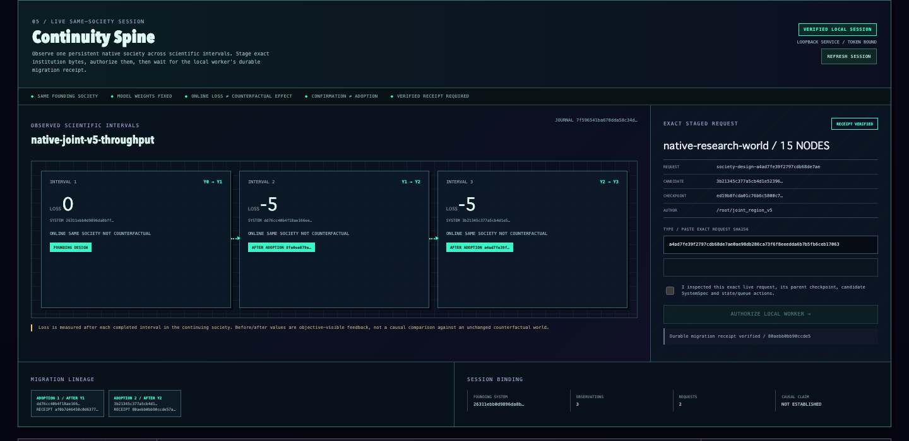

# A persistent native society with two objective-visible institutional revisions

Status: **complete online capability pilot**, not a causal optimization-benefit
or scientific-value result. One physical society, five fixed-weight Qwen3:8B
researchers, seed1301, three scientific years, two exact-hash external manifests
and two explicit durable adoptions. There is no population reset or added seed.

Source: `d68589f8bc8acf0f53f04619e5c0dd2bcf7a04dc`, clean detached experiment
`/Users/shiro/unktok/dev/science-utopia-lab-experiments/native-society-v6-a2`.
Raw root: `outputs/native-society-v6/run`.
Protocol: [persistent-society pilot](../protocols/campaigns/native-society-pilot-v6.md),
with a separately declared [RAG infrastructure retry](../protocols/campaigns/native-society-v6-rag-index-amendment.md).
[Independent audit](native-society-v6-a2.json) and
[actual browser checksums](native-society-v6-a2-ui-checksums.json) preserve provenance.

## What changed, and what actually ran

The explicit objective is only **minimize `L=-A`**, with A the number of actual
accepted native decisions in the newly completed interval. Quality, fairness and
participation are not hidden promotion criteria. Technical validity and compute
consent remain separate. Review scores are reported, not added to this loss.

| Completed interval | System active during that interval | Nodes / edges | Accepted / rejected | Raw reviews | Interval loss | New physical replies |
|---|---|---|---|---|---|---|
| 0→1 | Founding typed-activity version of the original world | 14 / 18 | 0 / 0 | 0 | 0 | 24 |
| 1→2 | Annual-sprint amendment authority + open registry | 15 / 21 | 5 / 0 | 15 | -5 | 44 |
| 2→3 | Annual-sprint complete-plan authority; bypass removed | 15 / 20 | 5 / 0 | 15 | -5 | 62 |

The first external request includes the complete founding graph, actual current
research assignments, actor IDs, loss, model/corpus/source and runtime contract.
The specialist's complete manifest is the **same initial design as failed a1**,
explicitly reused with new exact-request provenance. It is not another invention
or an additional a1 technical draft. Its arbitrary Python changes all actual
research assignments to one-year completion and requests native submission,
preserving chosen topics/keywords. An independently authored selection
implementation accepts every actually registered paper. Actual retrieval,
paper production, citations, peer review, funding and researcher lifecycle run;
accepted counts are not a synthetic substitute for these activities.

The second request contains the actual first loss path `[0,-5]`, all five live
authors, resources and generated sources. The specialist keeps the observed
throughput policy, prevents repeated prompt-suffix insertion, and rewrites code,
protocol and wiring so the complete plan is the required primary input to the
native effect consumer. It removes the original bypass and optional amendment
edge, preserving the new institution's memory. This is a meaningful authority/
process change with the **same number of nodes**, not a decorative node added
to manufacture structural diversity. It executes, but loss remains -5.

The author's identity is self-reported `/root/joint_region_v5` / Codex specialist,
not authenticated provider identity and **not Qwen-designed invention**. The
Qwen researcher weights/digest remain fixed; their responses are fresh. The
driver calls no additional designer-provider API; it makes no claim that external
Codex authoring is cost-free. No host source repair, implicit semantic wire or
extra draft is used.

## Same-society and browser evidence

The same founding configuration and response database are reopened at each
boundary. Complete saved-state/actor/project/paper/resource/RNG and original-rooted
migration checks retain one continuing scientific society. The browser sends one
exact consent POST at each boundary; a separate native worker installs the design.
The final UI re-verifies both actual saved receipts, including after full reload:

- After year1: `af0b7d46458c0d63771a31c52a794ce33b5de385ca8a5a0b41c89591b75602da`.
- After year2: `80aebb0bb90ccde57a46d153bf46d14c514a727e076a401a36c8d711cd3519fa`.

Final progress is `complete`, through year3, with three contiguous observations
and two durable adoptions. Browser errors, reload duplicate consent POSTs, and
desktop/mobile overflow are zero. The UI explicitly says **causal claim NOT
ESTABLISHED**. The temporary server and Chrome are stopped; its temporary profile
is recoverably moved to Trash, not left running as a fictitious background task.

## Independent measurement and runtime interpretation

Read-only audit re-extracts eight interval metrics from immutable whole-society
archives, verifies authoring feedback/response hashes, source/image/container
receipts, actor continuity and the response database. All36 raw files remain
byte-identical. There are130 physical researcher replies (cumulative24/68/130),
four checkpointed generated-code executions, and no uncheckpointed replies or
execution contexts in this completed trajectory. The audit calls no model or
generated code. End-boundary active authors are5/5/5; author resources570/640/710.
These are stocks, not per-year resource gains or independent replications.

Saved cumulative-call differences give77.11s,130.33s and193.96s of LLM time,
about401.40s total. This is **not experiment wall time**: retrieval/cache loading,
container execution, checkpoints, external authoring, operator consent and QA
are separate. The hardware/model/settings are not changed for a speedup claim.

The driver's historical `actual_activity_effects` counter counts **nonempty
amendment batches only**. Its third-year zero does not mean no plan effect:
the revised institution supplies the complete primary plan instead. Do not sum
those counts with source executions or call physical replay contexts independent
scientific effects.

## What this result does not establish

- `0→-5→-5` is an **online path**, not an unchanged-world counterfactual,
  held-out comparison or causal improvement. The second revision does not improve
  the measured count. Different project ages/calendar states also matter.
- All-acceptance and shorter projects are straightforward responses to a coarse
  count objective, not a useful new scientific institution or validated policy.
  Real retrieval/review activity does not validate scientific truth or social value.
- This session uses external free-source synthesis. The separately implemented
  factorized gradient route learns a distribution over supplied component edits;
  these are not already one endogenous differentiable designer.
- The original paper/corpus law, annual native phases and actor semantics remain.
  Whole-world pathwise gradients, source-content synthesis gradients and a
  designer improving its own algorithm remain research work, not scaling tasks.

The first attempt's29 replies, adoption and infrastructure failure remain in
[a1](native-society-v6-a1.md); they are not erased, merged into this path or counted
as replication. Later restart hardening is validated in a separate clean source
with scripted native QA, not silently injected into this experiment.
